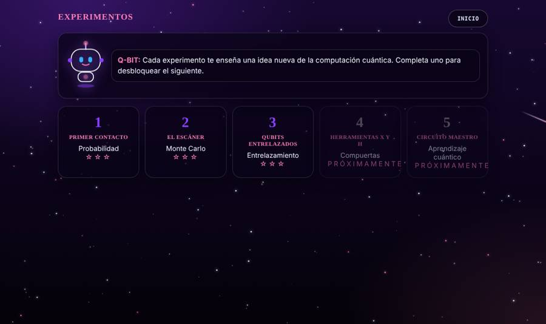
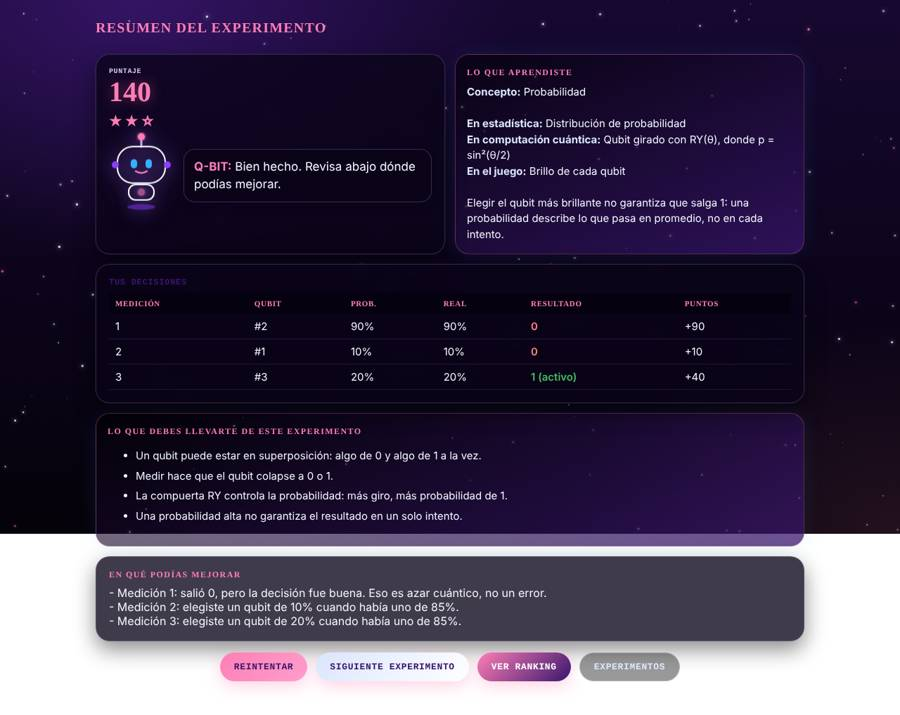
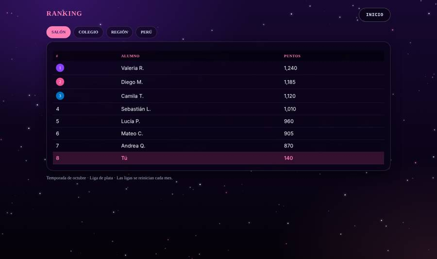

<div align="center">


# LABORATORIO Q

### Mide, estima y aprende computación cuántica

Juego educativo que enseña **probabilidad y estadística** a través de su **equivalente cuántico**,<br>usando qubits reales programados con **Qiskit**.


<br>

**Equipo**


</div>

---

## Contenido

1. [El problema](#-el-problema)
2. [Segmento objetivo](#-segmento-objetivo)
3. [La solución](#-la-solución)
4. [Cómo se juega](#-cómo-se-juega)
5. [Mapeo estadística y computación cuántica](#-mapeo-estadística-y-computación-cuántica)
6. [Arquitectura](#-arquitectura)
7. [Estructura del repositorio](#-estructura-del-repositorio)
8. [Cómo ejecutarlo](#-cómo-ejecutarlo)
9. [Modo clase y plan para colegios](#-modo-clase-y-plan-para-colegios)
10. [Estado actual y próximos pasos](#-estado-actual-y-próximos-pasos)
11. [Equipo](#-equipo)

---

##  El problema

- **La probabilidad se siente abstracta.** En el colegio se enseña con fórmulas y ejercicios que no conectan con algo que el estudiante quiera explorar.
- **La computación cuántica parece inalcanzable.** Se percibe como un tema exclusivo de universidades y laboratorios, cuando sus ideas base (probabilidad, medición, correlación) ya se pueden entender en secundaria.
- **Los profesores no tienen herramientas.** No existen recursos simples, en español y listos para clase que permitan enseñar estos conceptos sin ser experto.

##  Segmento objetivo

| Usuario | Qué necesita | Frecuencia de uso |
|---|---|---|
| **Escolares desde 10 años** (5.° de primaria a secundaria) | Aprender jugando, en sesiones cortas y motivadoras | **Una vez al día** (experimento del día y racha) |
| **Profesores** de matemática, ciencia y tecnología y computación | Una herramienta lista para clase, sin saber cuántica | **Una vez a la semana** (modo clase) |
| **Colegios** | Contenido tecnológico de frontera, sin hardware especial | Durante todo el año escolar |

> Aunque está pensado para escolares, cualquier persona que quiera iniciarse en computación cuántica puede usarlo.

##  La solución

**Laboratorio Q** convierte al estudiante en practicante de un laboratorio cuántico. Dentro de un criostato hay 9 cofres, y cada cofre es un **qubit real** simulado con Qiskit. Su misión es encontrar los qubits que estén en estado `|1⟩`, con pocas mediciones disponibles.

Cada experimento enseña un concepto de estadística y muestra, en el mismo momento, **qué está pasando dentro de la computadora cuántica**.

| Para el alumno | Para el profesor | Para el colegio |
|---|---|---|
| Partidas de 2 minutos, racha diaria y ranking | Modo clase tipo torneo y panel de avance | Corre en el navegador, sin costo de hardware |
| Aprende probabilidad y conceptos cuánticos de forma intuitiva | No necesita saber computación cuántica | Alineado a matemática y ciencia y tecnología |
| Recibe un resumen de lo que aprendió y en qué mejorar | Ve qué entendió cada estudiante | Lo diferencia con contenido de frontera |

**Puntaje justo:** el juego premia **decidir bien, no tener suerte**. Elegir un qubit con 90% de probabilidad vale más que acertar por casualidad en uno de 10%, porque el puntaje se basa en el **valor esperado** de cada decisión.

##  Cómo se juega

### Portada y guía
Q-Bit, el asistente del laboratorio, presenta la misión y acompaña al estudiante en cada paso.

### Experimentos
Cada experimento enseña una idea nueva.



### Lección previa
Antes de jugar, una lección corta explica **la idea**, **qué puede salir** al medir y **cómo se juega**.


### Experimento 1 · Primer contacto (probabilidad)
Cada cofre brilla según su probabilidad de dar `1`. Al elegir uno, el panel **Lo cuántico detrás** explica en palabras qué significa, qué puede salir y muestra el circuito de Qiskit.


### Experimento 2 · El escáner (Monte Carlo)
La probabilidad está oculta. El estudiante escanea un qubit (Qiskit mide el mismo circuito 5 veces) para estimarla, pero cada escaneo gasta energía.


### Experimento 3 · Entrelazamiento
Los qubits del mismo color están entrelazados con una compuerta CNOT: al medirlos solo puede salir `00` o `11`. Una medición revela los dos.


### Resumen del experimento
Puntaje, lo que aprendió, sus decisiones, **lo que debe llevarse** y **en qué podía mejorar**.



### Ranking
Ranking por salón, colegio, región y Perú, con ligas que se reinician cada mes.



##  Mapeo estadística y computación cuántica

| Concepto de estadística | Equivalente cuántico | En el juego | En Qiskit |
|---|---|---|---|
| Distribución de Bernoulli (probabilidad `p`) | Qubit rotado un ángulo θ | Brillo del cofre | `qc.ry(2*arcsin(sqrt(p)), 0)` |
| Muestreo de una variable aleatoria | Medición del qubit | Medir un cofre | `shots=1` |
| Método de Monte Carlo | Mediciones repetidas | Escáner | `shots=5` |
| Eventos correlacionados | Entrelazamiento | Cofres del mismo color | `qc.ry(θ, 0)` + `qc.cx(0, 1)` |
| Valor esperado | Probabilidad del estado `|1⟩` | Sistema de puntaje | `p = sin²(θ/2)` |

**Por qué funciona:** después de aplicar `RY(θ)` a un qubit en `|0⟩`, la probabilidad de medir `1` es `sin²(θ/2)`. Despejando, `θ = 2·arcsin(√p)`. Así cualquier probabilidad clásica se convierte exactamente en el ángulo de un qubit.

##  Arquitectura

```
┌──────────────────────┐      fetch       ┌──────────────────────┐      ┌──────────────────────┐
│      FRONTEND        │ ───────────────► │     API FastAPI      │ ───► │     Qiskit + Aer     │
│  HTML · CSS · JS     │                  │  /api/medir          │      │  RY · CNOT · medir   │
│  pantallas, puntaje, │ ◄─────────────── │  /api/escanear       │ ◄─── │  shots = 1 o N       │
│  ranking (clásico)   │   resultados     │  /api/entrelazados   │      │  (cuántico)          │
└──────────────────────┘                  └──────────────────────┘      └──────────────────────┘
```

| Capa | Tecnología | Responsabilidad |
|---|---|---|
| Cuántica | Qiskit, Qiskit Aer | Crear los circuitos de cada qubit, entrelazarlos y medirlos |
| API | FastAPI | Exponer el motor cuántico y servir el juego |
| Clásica | HTML, CSS, JavaScript | Interfaz, lecciones, puntaje, resumen y ranking |

Si el backend no está disponible, el frontend cambia a un modo demo con simulación local para no interrumpir la experiencia.

##  Estructura del repositorio

```
META-Q/
├── backend/
│   ├── app/
│   │   ├── main.py        # API FastAPI y servidor del juego
│   │   ├── quantum.py     # Motor cuántico con Qiskit
│   │   └── schemas.py     # Modelos de entrada de la API
│   └── requirements.txt
├── frontend/
│   ├── index.html         # Pantallas del juego
│   ├── css/styles.css     # Estilos y animaciones
│   ├── js/game.js         # Lógica del juego y llamadas a la API
│   └── assets/
├── docs/
│   └── capturas/          # Imágenes de este README
├── legacy/                # Primera versión en Streamlit
├── requirements.txt
└── render.yaml            # Despliegue en Render
```

##  Cómo ejecutarlo

**Requisitos:** Python 3.11 o superior.

```bash
git clone https://github.com/stella5555/META-Q.git
cd META-Q
pip install -r requirements.txt
uvicorn backend.app.main:app --reload
```

Abrir **http://localhost:8000**

### Endpoints de la API

| Método | Ruta | Cuerpo | Qué hace |
|---|---|---|---|
| `GET` | `/api/salud` | | Verifica que el motor cuántico esté activo |
| `POST` | `/api/medir` | `{"p": 0.9}` | Mide un qubit una vez |
| `POST` | `/api/escanear` | `{"p": 0.7, "shots": 5}` | Mide el mismo circuito N veces (Monte Carlo) |
| `POST` | `/api/entrelazados` | `{"p": 0.5}` | Mide dos qubits entrelazados |

### Despliegue
En [Render](https://render.com): crear un *Web Service* desde este repositorio. El archivo `render.yaml` ya define los comandos de instalación e inicio.

##  Modo clase y plan para colegios

**En el salón (10 a 12 minutos):**
1. El profesor proyecta el experimento y los alumnos se unen desde su celular con un código.
2. Se juega un **torneo de 5 rondas de 60 segundos**, cada una con un tablero nuevo y dificultad creciente.
3. Entre rondas se muestran las estadísticas del salón (por ejemplo, cuántos escanearon antes de medir) y el profesor abre la discusión.
4. El ranking se acumula y se actualiza en vivo.

**En casa:** experimento del día igual para todo el país, modo práctica, duelos entre amigos y tareas asignadas por el profesor.

**Adopción:**

| Etapa | Acción |
|---|---|
| Piloto | Un colegio, dos salones, cuatro semanas, midiendo aprendizaje y uso diario |
| Expansión | Convenios con redes de colegios y rankings regionales |
| Escala | Torneo nacional con universidades y aliados del ecosistema cuántico |

##  Estado actual y próximos pasos

| Funciona hoy | Limitaciones | Próximos pasos |
|---|---|---|
| 3 experimentos con Qiskit real | Corre en el simulador Aer | Experimento 4: compuertas X y H (interferencia) |
| Lecciones previas y panel explicativo | El modo clase está diseñado, no programado | Experimento 5: circuito maestro con IA (descenso de gradiente) |
| Resumen con aprendizajes y errores | El ranking usa datos de ejemplo | Piloto en un colegio |
| API FastAPI + interfaz completa | | Ejecución en hardware cuántico real de IBM |

##  Equipo

| Integrante |
|---|
| María Fernanda Hallasi Yucra |
| Nicolás Andrés Huaylla Pineda |
| Leyssy Sofía Mamani Yucra |
| Hilary Penélope Cruz Cruz |

**Créditos:** [Qiskit](https://www.ibm.com/quantum/qiskit) · [Qiskit Aer](https://github.com/Qiskit/qiskit-aer) · [FastAPI](https://fastapi.tiangolo.com)

<div align="center">

---

**LABORATORIO Q** · Qiskit Fall Fest 2026 · Lima, Perú

</div>
