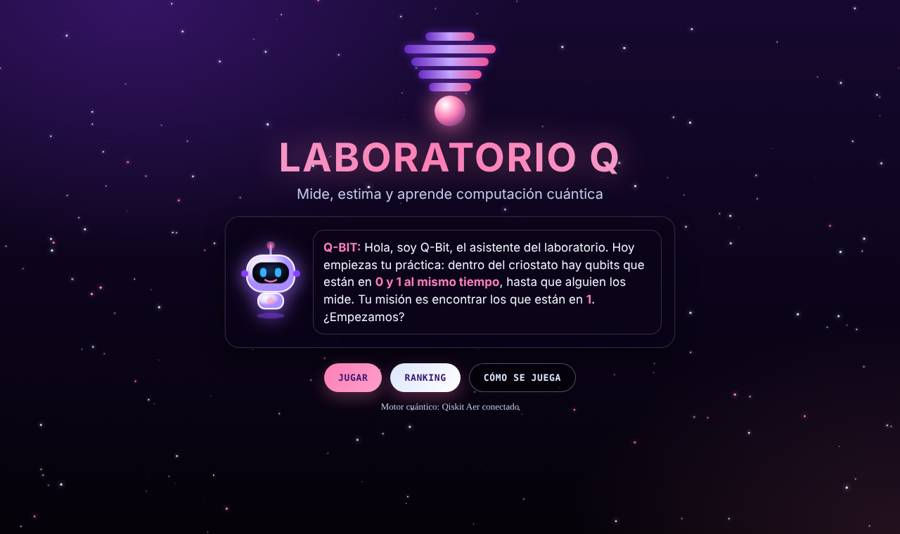
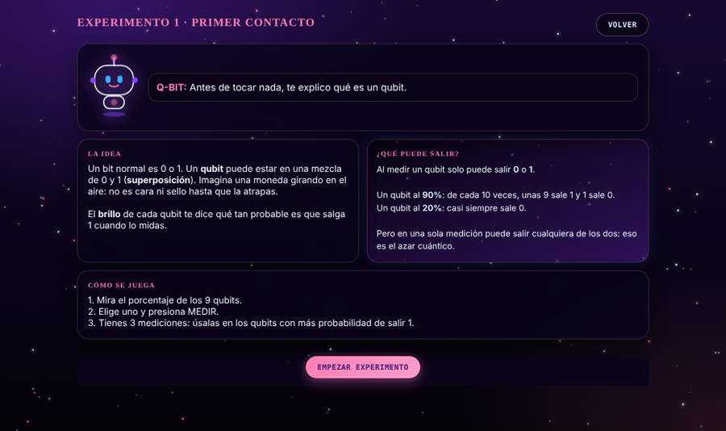
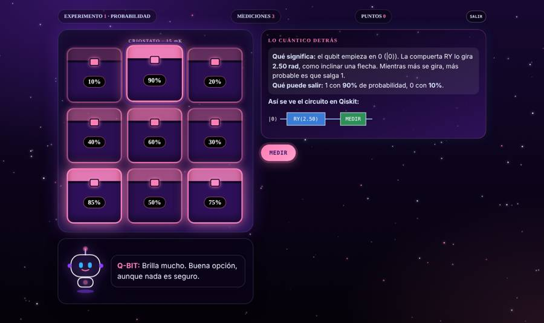
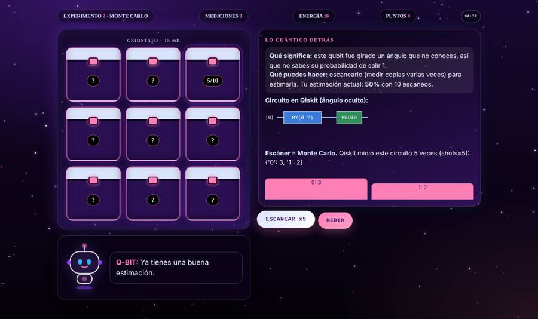
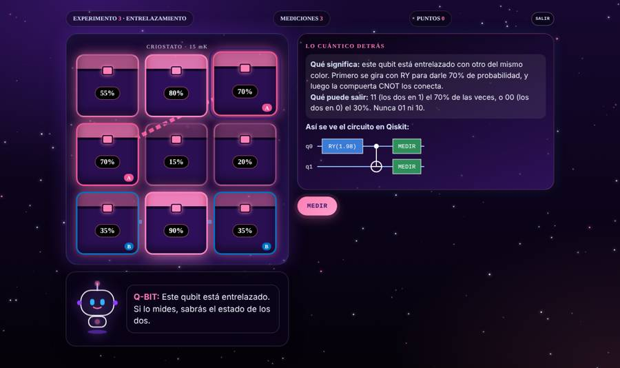

<div align="center">



# LABORATORIO Q

**Mide, estima y aprende computación cuántica.**<br>
Juego educativo que enseña probabilidad con qubits reales programados en Qiskit.


### Contribuidores

<table>
<tr>
<td align="center"><b>María Fernanda<br>Hallasi Yucra</b></td>
<td align="center"><b>Nicolás Andrés<br>Huaylla Pineda</b></td>
<td align="center"><b>Leyssy Sofía<br>Mamani Yucra</b></td>
<td align="center"><b>Hilary Penélope<br>Cruz Cruz</b></td>
</tr>
</table>

</div>

---

## El problema

La probabilidad se siente abstracta en el colegio, la computación cuántica parece solo para universidades y los profesores no tienen herramientas para enseñarla sin ser expertos.

## Para quién es

| Usuario | Uso |
|---|---|
| **Escolares desde 10 años** | Una partida diaria de 2 minutos, con racha y ranking |
| **Profesores** | Modo clase semanal tipo torneo, sin necesidad de saber cuántica |
| **Colegios** | Corre en el navegador, sin hardware especial |

## La solución

El estudiante es practicante en un laboratorio cuántico. Cada cofre del criostato es un **qubit real simulado con Qiskit**, y su misión es encontrar los que están en `|1⟩` con pocas mediciones. Antes de cada experimento hay una lección corta, y en cada jugada el panel **Lo cuántico detrás** explica qué pasa dentro del circuito. El puntaje premia **decidir bien, no tener suerte**.

<table>
<tr>
<td><br><sub><b>Lección previa:</b> la idea y qué puede salir</sub></td>
<td><br><sub><b>Experimento 1:</b> probabilidad</sub></td>
</tr>
<tr>
<td><br><sub><b>Experimento 2:</b> escáner (Monte Carlo)</sub></td>
<td><br><sub><b>Experimento 3:</b> entrelazamiento</sub></td>
</tr>
</table>

## Estadística ↔ computación cuántica

| Estadística | Cuántica | En el juego | Qiskit |
|---|---|---|---|
| Probabilidad `p` | Qubit rotado θ | Brillo del cofre | `ry(2*arcsin(sqrt(p)))` |
| Muestreo | Medición | Medir | `shots=1` |
| Monte Carlo | Mediciones repetidas | Escáner | `shots=5` |
| Eventos correlacionados | Entrelazamiento | Cofres del mismo color | `ry` + `cx` |

## Arquitectura

```
Frontend (HTML, CSS, JS)  →  API FastAPI  →  Qiskit + Aer
   interfaz y puntaje        /api/medir       RY, CNOT, shots
                             /api/escanear
                             /api/entrelazados
```

## Cómo ejecutarlo

```bash
pip install -r requirements.txt
uvicorn backend.app.main:app --reload
```

Abrir **http://localhost:8000**

## Estado y próximos pasos

- **Funciona hoy:** 3 experimentos con Qiskit real, lecciones, resumen y ranking de ejemplo.
- **Limitaciones:** corre en simulador Aer; el modo clase está diseñado, no programado.
- **Siguiente:** compuertas X y H, circuito maestro con IA, piloto en un colegio y hardware IBM.

<div align="center">

---

**LABORATORIO Q** · Qiskit Fall Fest 2026 · Lima, Perú

</div>
